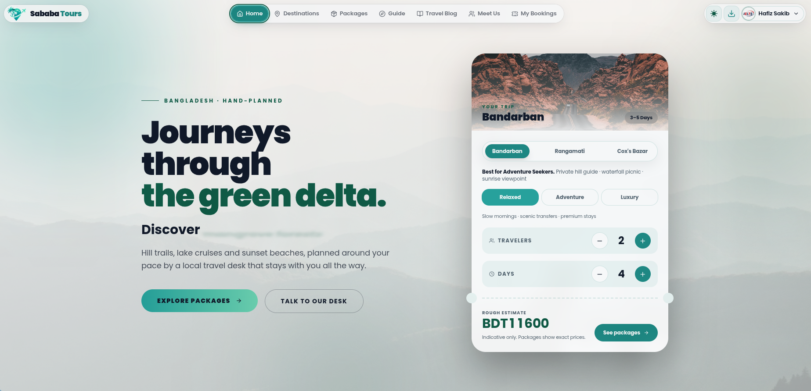

# 🌴 Sababa Tours — Frontend

A travel-agency web app for hand-planned journeys across Bangladesh. Visitors browse destinations and packages, plan a trip with a live price estimate, send a booking request, and — once the travel desk approves it — pay an advance and the balance online. The travel desk manages everything from an admin dashboard.

🔗 **Live site:** [sababa-tours.vercel.app](https://sababa-tours.vercel.app/)
🔗 **Backend repo:** `Sababa-Tours-Backend` (Express + MongoDB, see its README)



---

## ✨ Features

**For travelers**
- 🏠 Homepage with a **live trip planner** (destination, style, travelers, days → rough BDT estimate)
- 🗺️ Destinations, packages, travel guide, blog (search + category filter) and a "Meet Us" page
- 🔐 Sign in with Firebase Authentication (email/password, forgot-password flow)
- 📅 Booking request form with trip calendar and instant confirmation modal
- 🧾 **My Bookings**: status, edit, cancel (until 5 days before the trip), delete cancelled bookings
- 💳 **Billing page** per booking: 30% advance countdown (72 h hold), pay any amount, payment history, printable invoice
- 🌗 Day / night theme, installable **PWA** with offline page

**Checkout (demo gateway)**
- Centered payment modal with progress bar, animated steps and receipt
- **Card:** Motion Brew "Add card" empty state → card form with live card preview, brand detection, Luhn check, expiry/CVC validation, **random test-card button**, optional saved card (brand, last 4, name, expiry only — never the number or CVC)
- **bKash / Nagad:** account number → SMS code → wallet PIN
- Bank-style 6-digit verification code, processing steps, success receipt with transaction ID, and a failure/retry state
- ⚠️ This is a **demo**: no real money moves and no card data leaves the browser

**For the travel desk (admin)**
- Dashboard with totals, status split, popular packages and upcoming confirmed trips
- Booking modal: customer details, WhatsApp link, payment summary, confirm / cancel / move back to pending, edit details, invoice, hold-to-delete
- Confirming a booking on a free date automatically starts the 30% advance window
- Package (service) management

---

## 🛠️ Tech Stack

| Technology | Purpose |
| --- | --- |
| React 18 (Create React App / `react-scripts` 5) | UI framework |
| Tailwind CSS 3 | Styling with day/night colour tokens |
| `motion` (`motion/react`) | Animations, Motion Brew components |
| React Router 6 | Routing and protected routes |
| Firebase Authentication | Login, registration, ID tokens sent to the API |
| `react-hot-toast` | Notifications |
| `react-icons` | Icons |
| Service worker + manifest | PWA / offline support |

---

## 🚀 Getting Started

### 1. Prerequisites
- Node.js 18+ and npm
- A Firebase project with **Email/Password** sign-in enabled
- The backend running locally (port `5000`) or the deployed one

### 2. Install
```bash
git clone <your-frontend-repo-url>
cd Sababa-Tours-main
npm install
```

### 3. Environment variables
Create a `.env` file in the project root:

```env
REACT_APP_apiKey=your_firebase_api_key
REACT_APP_authDomain=your_project.firebaseapp.com
REACT_APP_projectId=your_project_id
REACT_APP_storageBucket=your_project.appspot.com
REACT_APP_messagingSenderId=your_sender_id
REACT_APP_appId=your_app_id
```

> Never commit real keys to a public repo. `.env` is listed in `.gitignore`.

### 4. API address
`src/config.js` picks the backend automatically:

| Mode | API base URL |
| --- | --- |
| `npm start` (development) | `http://localhost:5000` |
| `npm run build` (production) | `https://sababa-tours-backend.onrender.com` |

Change the production URL there if you deploy your own backend.

### 5. Run
```bash
npm start        # dev server on http://localhost:3000
npm run build    # production build in /build
```

---

## 🧭 Routes

| Path | Page | Access |
| --- | --- | --- |
| `/` | Home | public |
| `/services` | Packages | public |
| `/destinations` | Destinations | public |
| `/guide` | Travel guide | public |
| `/blogs` | Travel blog | public |
| `/meet-us` | About + contact | public |
| `/login`, `/register`, `/forgot-password` | Auth | public |
| `/booking/:bookingId` | Book a package | signed in |
| `/my-bookings` | My bookings | signed in |
| `/my-bookings/:bookingId/billing` | Billing, pay, invoice | signed in |
| `/admin` | Admin dashboard | admin only |

`/about` and `/contact` redirect to `/meet-us`.

---

## 💰 Payment Rules

1. Customer sends a request → status **pending**.
2. Admin presses **Confirm**:
   - trip date is free → **awaiting payment**: 30% advance due within **72 hours**
   - date already taken → **confirmed** immediately, no advance
3. Customer pays any whole amount up to the balance. Once the total paid reaches the 30% advance, the booking becomes **confirmed** automatically.
4. Advance not paid in 72 h → booking is **cancelled** automatically.
5. Customers can edit or cancel only until **5 days** before the trip; the admin is never limited.

The numbers live in `src/Components/Utilities/payment.js` and `bookingRules.js`. The **server is the authority**; these files only decide what the screens show. More detail is in `docs/BACKEND_PAYMENT_RULES.md` and `docs/BACKEND_BOOKING_RULES.md`.

---

## 📂 Project Structure

```bash
Sababa-Tours-main/
├── public/                     # index.html, manifest, service worker, icons, offline page
├── docs/                       # backend rules the UI mirrors
└── src/
    ├── App.js                  # routes
    ├── config.js               # API base URL
    ├── Firebase.init.js        # Firebase setup (reads REACT_APP_* vars)
    ├── theme.js, App.css       # day / night tokens
    ├── data/travel.js          # destinations, trip-planner data
    ├── assets/                 # logos, reviews, README screenshots
    └── Components/
        ├── Admin/              # AdminDashboard (booking modal, stats, packages)
        ├── Auth/               # Login, Registration, ForgotPassword, RequireAuth
        ├── Billing/            # BillingPage, PayModal, Invoice, HoldBanner
        ├── Booking/            # Booking form, success modal, edit modal
        ├── MyBookings/         # customer bookings list
        ├── Home/ Pages/ Services/ Footer/ Navbar/
        ├── Utilities/          # payment.js, cards.js, bookingRules.js, authFetch.js
        └── ui/                 # shared UI + brew/ (Motion Brew ports, AddCard)
```

---

## 🧪 Trying the Checkout

1. Register or sign in, send a booking request.
2. In `/admin`, sign in with an admin account and **Confirm** the booking.
3. Open **My Bookings → Billing → Pay**.
4. Choose **Card** → *Add card* → **Use test card (random)** → Pay. Enter the code shown in the demo SMS banner (tap it to autofill).
5. For **bKash / Nagad** use **Fill demo number**, the demo code, then any PIN.

---

## 🌍 Deployment

- **Frontend:** Vercel (`vercel.json` handles SPA rewrites; `public/_redirects` for Netlify-style hosts). Add the `REACT_APP_*` variables in the host's environment settings.
- **Backend:** Render (see the backend README). Make sure the frontend's domain is allowed in the backend `CORS_ORIGINS`.

---

## 🤝 Credits

- Animated components adapted from [Motion Brew](https://motion-brew.com) (MIT License)
- Icons by React Icons, fonts: Poppins and Hind Siliguri

Built by **Hafiz Sakib** · [Portfolio](https://hafizsakib.vercel.app/)
